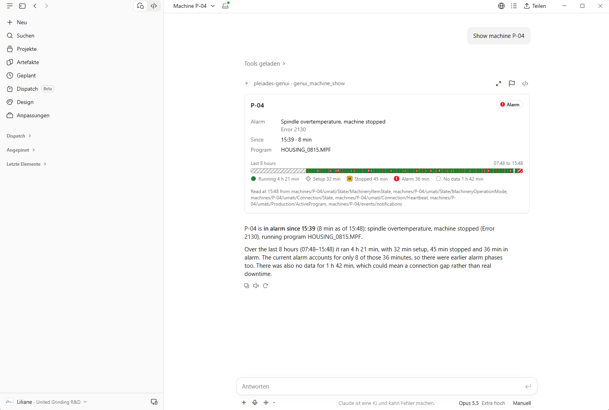

# A tour of the demo

Six stops through the running demo, for someone who has never seen it: what you see, and where it lives in
the code. The screenshots were taken from the demo stack on one computer; your machines will be in other
states, because the simulator keeps changing them.

With a coding agent in the repository you can ask for this tour: "give me a tour". The agent then walks you
through the stops in your running stack, see [`AGENTS.md`](../AGENTS.md).

1. [Start](#1-start)
2. [Home](#2-home)
3. [The page of one machine](#3-the-page-of-one-machine)
4. [The chat beside the page](#4-the-chat-beside-the-page)
5. [When a machine goes silent](#5-when-a-machine-goes-silent)
6. [Where to change what](#6-where-to-change-what)

## 1. Start

One command builds and starts everything. It needs Docker and nothing else, see the
[development setup](development-setup.md).

```bash
docker compose up -d --build
```

The stack is ready when every container reports healthy: the broker, the database, the two APIs with their
persistence workers, the generative UI backend, the app and one simulator per machine.

```bash
docker compose ps --format "table {{.Service}}	{{.Status}}"
```

```text
SERVICE                  STATUS
app                      Up 3 minutes (healthy)
broker                   Up 3 minutes (healthy)
events-api               Up 3 minutes (healthy)
events-persistence       Up 3 minutes (healthy)
genui-mcp                Up 3 minutes (healthy)
mongodb                  Up 3 minutes (healthy)
simulator-m-02           Up 3 minutes (healthy)
simulator-p-04           Up 3 minutes (healthy)
simulator-p-07           Up 3 minutes (healthy)
timeseries-api           Up 3 minutes (healthy)
timeseries-persistence   Up 3 minutes (healthy)
```

| Address | What answers there |
|---|---|
| <http://localhost:5600/> | The example app, the subject of stops 2 to 5. It answers on this computer only. |
| <http://localhost:5520/mcp> | The generative UI backend, an MCP server. The app reads every value from it. |
| <http://localhost:5500/> | The Timeseries API: Swagger UI, and MCP at `/mcp`. |
| <http://localhost:5510/> | The Events API: Swagger UI, and MCP at `/mcp`. |
| `localhost:1883` | The MQTT broker the simulators publish to. |

**In the code:** [`compose.yaml`](../compose.yaml) is the stack, [`.env.example`](../.env.example) names every
port and setting. The three simulated machines, P-04, P-07 and M-02, are the three `simulator-*` services.

## 2. Home

Home asks "what needs you?". It sorts the machines by what they do now: first the ones in alarm, stopped or
without data, then the ones in setup, then the running ones, and it reads them again every ten seconds.


In the picture two machines need you. P-04 is stopped without a recorded reason, P-07 is stopped with the
warning "Safety door open, machining interrupted", and both say since when. M-02 runs the program
`SHAFT_4711.MPF`. A row leads to the page of its machine, and "Ask why" starts a chat about it (stop 4). The
field "Ask a question" in the header starts a chat too.

**In the code:** [`apps/app/src/routes/index.tsx`](../apps/app/src/routes/index.tsx) is the page and its
groups, [`apps/app/src/machines/machine-item.tsx`](../apps/app/src/machines/machine-item.tsx) draws a row and a
tile. The values are the result of the tool `genui_machine_list`
([`apps/genui-mcp/src/machines.ts`](../apps/genui-mcp/src/machines.ts)). Which value is which state is decided
in one file, [`packages/cards/src/machine/state.ts`](../packages/cards/src/machine/state.ts).

## 3. The page of one machine

A click on a machine opens its page, here <http://localhost:5600/machines/P-04>. It shows the machine card:
what the machine does now, and what it did over the last eight hours. It needs no language model.


The card has three parts. On top is the state with its reason, since when it holds, and the active program.
In the middle is the band: one stripe from eight hours ago until now, coloured by state, and below it the
total of each state. The hatched part of this band is "No data": the stack of the picture had been running
for about two hours, and before that nobody published. At the bottom the card names the topics it read, so
every value can be traced to the broker.

**In the code:** [`apps/app/src/routes/machines.$machine.tsx`](../apps/app/src/routes/machines.%24machine.tsx)
is the page. The card is
[`packages/cards/src/machine/machine-card.tsx`](../packages/cards/src/machine/machine-card.tsx), its band
[`state-band.tsx`](../packages/cards/src/machine/state-band.tsx), and the shape of its values the contract in
[`contract.ts`](../packages/cards/src/machine/contract.ts). The tool `genui_machine_show` returns the values
and `genui_span_list` the spans of the band; the totals are added up in
[`apps/genui-mcp/src/history.ts`](../apps/genui-mcp/src/history.ts), never by a language model.

## 4. The chat beside the page

The button at the right end of the header opens the chat. It is a panel beside the page, and the page stays
where it is: you chat about what you see. A language model answers and calls the tools of the generative UI
backend, and the app draws the values of a tool call itself, with the same card as the page.


The picture shows the end of one chat, with a language model configured. The question was "What did P-04 do
over the last 8 hours?". The chat lists each step of the model, here "Read the guide of the backend" and,
further up, "Read the machine". It draws the card from the values of the tool, and the model sums it up in a
few sentences. The numbers are the tool's and the wording is the model's: it writes 10 minutes of alarm
where the card says 9. The card on the left is one minute newer than the one in the chat: the page reads
again, an answer shows what was true when it was given.

The chat needs a language model, and the demo starts without one. Then the panel says "No language model
configured" and names the missing settings; Home and the machine pages work as before. To configure a model,
copy `.env.example` to `.env`, fill one of the three blocks and start the stack again:

| Block | Settings |
|---|---|
| Anthropic | `ANTHROPIC_API_KEY`, `ANTHROPIC_MODELS` |
| OpenAI | `OPENAI_API_KEY`, `OPENAI_MODELS` |
| Any endpoint that speaks OpenAI's chat completions, for example a local model server | `LLM_BASE_URL`, `LLM_MODELS`, and `LLM_API_KEY` if it wants one |

The chat has no sign-in, and whoever reaches the port chats at the cost of the owner of the key. Read
[Language models](../apps/app/README.md#language-models) before you open the port to a network.

With more than one model, the input field offers a choice. The first model answers until a chat picks
another one, and the choice stays with that chat.


The models in the picture are the ones this stack was configured with; yours are the names in your `.env`.
The three questions above are suggestions to begin with.

**In the code:** [`apps/app/src/chat/`](../apps/app/src/chat). `chat-sidebar.tsx` is the panel with the model
picker, `assistant.server.ts` the agent harness that talks to the model and calls the tools, `models.ts`
reads which models the settings name, `tool-results.ts` says what the app draws for which tool, and
`suggestions.ts` holds the three questions.

### The card in another host

The machine card is also an MCP App: one HTML file that the generative UI backend serves as the resource
`ui://genui/machine`, so a desktop chat that shows MCP Apps draws the same card next to its answer. How to
connect such a host is in [The machine card for other hosts](../apps/genui-mcp/README.md#the-machine-card-for-other-hosts).

> **Screenshot missing.** The machine card inside a desktop host was out of reach when this tour was
> written. Add it as `docs/images/tour/machine-card-in-host.png` and replace this note with the image.

<!-- TODO(tour):  -->

## 5. When a machine goes silent

A machine that stops publishing is not "stopped": nothing is known about it. Try it, and stop one simulator.

```bash
docker compose stop simulator-m-02
```

After 30 seconds without a sign of life, Home moves the machine to "Needs you" with the state "No data".


The row says what is known: no data from the adapter since 20:34, and the last thing the machine reported
before it fell silent. The other two machines are not affected. P-07 runs with an open warning, which its
tile shows. Start the simulator again, and within a few seconds the machine is back with a fresh "since":
a silence ends a run, because what happened in between is not known.

```bash
docker compose start simulator-m-02
```

**In the code:** the rule is in [When a machine is there](../apps/genui-mcp/README.md#when-a-machine-is-there).
[`apps/genui-mcp/src/liveness.ts`](../apps/genui-mcp/src/liveness.ts) finds the stretches of silence, and the
30 seconds are a constant in [`packages/cards/src/machine/contract.ts`](../packages/cards/src/machine/contract.ts).
The topics that count as a sign of life are in the [MQTT binding](../contracts/mqtt/README.md).

## 6. Where to change what

Each part has a section "What is where" that maps its files:

| You want to change | Start here |
|---|---|
| A page, the layout or the chat of the app | [`apps/app`: What is where](../apps/app/README.md#what-is-where) |
| A tool, its text for a model, or how states and silence are computed | [`apps/genui-mcp`: What is where](../apps/genui-mcp/README.md#what-is-where) |
| A card, its contract, the wording or the colours of a state | [`packages/cards`: What is where](../packages/cards/README.md#what-is-where), and [A new card](../packages/cards/README.md#a-new-card) |
| What a machine publishes and how it is stored | [`contracts/`](../contracts/README.md) first, then the .NET services under [`source/`](../source) |

Below the app are the two APIs. Each one offers the same queries twice: over REST for applications, with a
Swagger UI to try them, and over MCP for agents.


The picture shows the Swagger UI of the Timeseries API at <http://localhost:5500/>, in its light mode; the
lamp at the top right switches it. The Events API has the same page at <http://localhost:5510/>. Open an
endpoint and choose "Try it out" to send a request to the running stack.

| API | REST | MCP | Contract |
|---|---|---|---|
| Timeseries | <http://localhost:5500/>, OpenAPI at `/openapi/v1.json` | `http://localhost:5500/mcp` | [`contracts/openapi`](../contracts/openapi/README.md), [`contracts/mcp`](../contracts/mcp/README.md) |
| Events | <http://localhost:5510/>, OpenAPI at `/openapi/v1.json` | `http://localhost:5510/mcp` | the same |
| Generative UI | none: it is an MCP server only | `http://localhost:5520/mcp` | [`contracts/mcp`](../contracts/mcp/README.md), [`packages/cards`](../packages/cards/README.md) |

To use the tools from your own agent, add the three MCP addresses to any MCP client; the entry to copy is in
[`contracts/mcp`](../contracts/mcp/README.md).

---

The screenshots are 1383 × 868 pixels, taken in Chrome in the light theme of the app. To replace one, keep
the file name under [`images/tour/`](images/tour) and describe in the text what the new picture shows.
Whoever changes what a stop shows keeps the stop current, see [CONTRIBUTING.md](../CONTRIBUTING.md#conventions);
CI checks that every pointer of this page still has its target.
